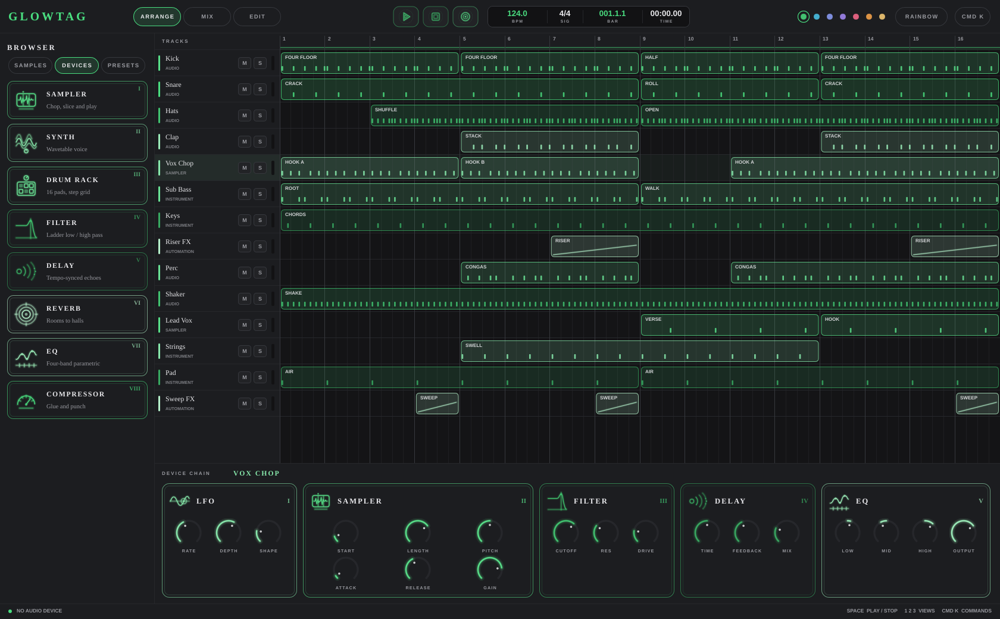

# GLOWTAG

A personal, MIDI- and sampling-focused DAW for macOS, built natively with C++ and [JUCE](https://juce.com).
The look is graffiti art drawn as calm neon line work: thin outlines, serif caps headings and
detailed glowing icons, on a dark grey background. One theme colour by default (green), with a
Rainbow mode that uses the full card palette.



## Build on a Mac

You need Xcode (from the App Store) and CMake (`brew install cmake`).

```sh
git clone https://github.com/jackhenrymillar-collab/glowtag.git
cd glowtag
cmake -B build -G Xcode          # first run downloads JUCE 8.0.4, takes a few minutes
open build/GLOWTAG.xcodeproj     # pick the "Glowtag" scheme and press Run
```

Or build from the terminal:

```sh
cmake --build build --config Release
open build/Glowtag_artefacts/Release/GLOWTAG.app
```

If you already have JUCE checked out, add `-DGLOWTAG_JUCE_DIR=/path/to/JUCE` to the first command.

## Using it

| Key | Action |
| --- | --- |
| Space | Play / stop. Stop returns to where play started; stop again to go to the start |
| A W S E D F T G Y H U J K O L P | Play notes on the selected track (Z and X change octave) |
| R | Arm recording. Notes you play while playing are recorded into the selected track |
| Delete | Delete the selected clip (Arrange) or note (Edit) |
| Cmd D | Duplicate the selected clip |
| 1 / 2 / 3 | Arrange / Mix / Edit |
| Cmd K | Command palette (views, transport, theme) |
| Up / Down | Select track |

Any MIDI keyboard that is plugged in plays and records into the selected track too.

**Arrange**
- Click the ruler to move the playhead. Drag along the strip under the bar numbers to set the loop, and toggle looping with the loop button in the top bar.
- Drag clips to move them (between lanes too), drag their right edge to resize, Alt-drag to copy, and right-click for duplicate, delete and loop length.
- Double-click an empty lane to make a new clip, or a clip to open it in Edit.
- Drop audio files (wav, aiff, flac, mp3) onto a lane to make audio clips.
- Cmd + scroll zooms, scroll moves along the timeline.

**Edit** (piano roll for the selected clip)
- Pencil: click to draw a note and drag right to set its length. Drag notes to move them, drag the right edge to resize.
- Scissors split a note, the velocity tool drags velocity, and the lane under the grid sets velocity per column.
- Double-click a note (or press Delete) to remove it. Scroll moves up and down the keyboard.
- Loop sets how often the clip's notes repeat inside it.

**Devices** (bottom panel) is a modular patch that really runs the sound. Instruments are virtual
analog: the Synth has two drifting band-limited oscillators and a sub through a transistor ladder
filter with analog-curve envelopes, the Sampler plays built-in or dropped samples, and the Drum Rack
has sixteen pads (click to hear, right-click to choose a sample, drop a file on a pad). Effects:
Filter (ladder), Drive (tube / tape / fuzz / fold), Delay (tempo-synced, ping-pong), Reverb, EQ,
Compressor, and an LFO that can modulate any knob. The panel is modular. Each module you add wires itself in (effects go at the end of the
chain, an LFO patches into the last module's first free knob). Drag between jacks to patch,
pull a plugged-in jack to re-wire it, double-click a cable to remove it, drag a module's header
to move it, and right-click a module to remove it. Double-click a device in the browser to add it.
Tidy lines everything up in signal order.

**Sequence** (the rolling sequencer). Press SEQ on an instrument or sampler track and its clips
make way for a Eurorack-style rack that plays the track live, in time with the song. The rack
starts as Clock, Steps, Quantise and Out, already patched. Add modules from the browser's
Sequence tab or the rack's own menu; each wires itself in sensibly and can be re-patched by
dragging between jacks (pull a plugged jack to move its lead, double-click a lead to remove it).
Right-click a module to move or remove it; Back to clips returns the track to its arrangement.

| Module | What it does |
| --- | --- |
| Clock | Sixteenths from the song (divided or multiplied), swing, or free-running with the transport stopped. Reset, Clk and Bar outs |
| Steps | 16 pitch sliders with a gate button under each. Gate length, slide, octave, five directions (forward, reverse, pendulum, brownian, random), length. Cv inputs for direction, probability and length |
| Euclid | Hits spread evenly round a circle of steps, rotatable. Accent on the downbeat |
| Turing | A shift-register melody that evolves with probability and locks into a loop at zero |
| Burst | Ratchets: a burst of gates from one trigger, with a velocity ramp |
| Chance | Lets gates through by probability, drifts the pitch, remembers, and can lock its decisions into a loop |
| Quantise | Pulls any pitch onto a scale (twelve scales, any root), nearest / up / down |
| Mutate | Slowly wanders away from the pitch coming in |
| Circadian | A slow day-and-night cycle following song bars, the wall clock (a minute to a day) or real daylight. Cv, Dawn, Noon, Dusk and inverted outs |
| Tide | Tempo-synced LFO from a sixteenth to eight bars, five shapes |
| Out | Plays the track's instrument: mono or four voices, octave, and a Mod lead that moves the instrument's character knob |

**Mix**: faders, pan knobs and mute / solo all affect the sound.

## Tests

Offline checks for the engine (transport, loop, clips, live MIDI, recording, patching, the sequencer rack):

```sh
cmake -B build -G Xcode -DGLOWTAG_TESTS=ON
cmake --build build --target GlowtagTests --config Debug
./build/GlowtagTests_artefacts/Debug/GlowtagTests
```

## Code layout

```
Source/
  Main.cpp              app and window
  MainComponent.*       owns the project, engine and views; layout and shortcuts
  Theme.*               colours (one-colour shades or Rainbow) and fonts
  Engine/
    Project.*           tracks, clips, step patterns, tempo
    Patch.*             modular device patch per track: modules, jacks, cables, auto-wiring
    Graph.*             the running audio side of a patch (virtual analog nodes)
    Sequencer.*         rolling sequencer rack: modules, cables, auto-wiring, and the tick-based runtime
    AudioEngine.*       plays clips, live MIDI and sequencer racks through each track's graph
  UI/
    Icons.*             glowing line-art icons and panel drawing
    GlowLookAndFeel.*   pill buttons, glowing knobs, faders
    TopBar, BrowserPanel, TrackList, ArrangerView, DevicePanel,
    SequencerPanel, MixerView, EditorView, StatusBar
```

## Roadmap

1. **Foundation** (done): app shell, audio engine, themed UI with Arrange, Mix and Edit.
2. **Core engine** (done): timeline with MIDI and audio clips, loop, metronome, piano roll editing, MIDI keyboard playing and recording.
3. **Sounds and devices** (done): virtual analog synth, sampler, drum rack and effects running through the modular patch.
3b. **Eurorack rolling sequencer** (this version): a per-track alternative to clips, with module-style visuals.
4. **Mix, Edit and polish**: full mixer routing, full piano roll, AU / VST hosting, saving projects.
