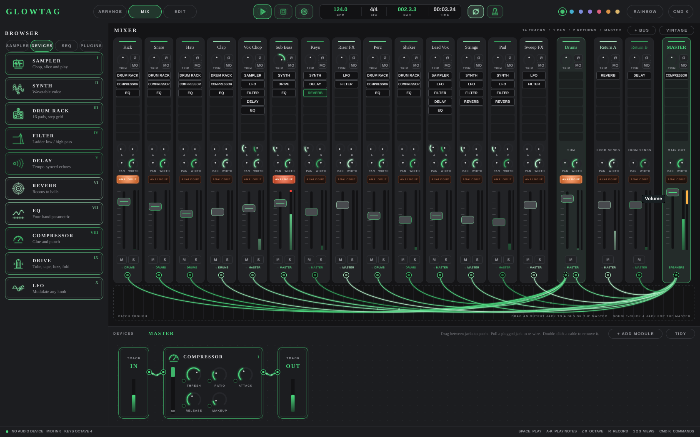
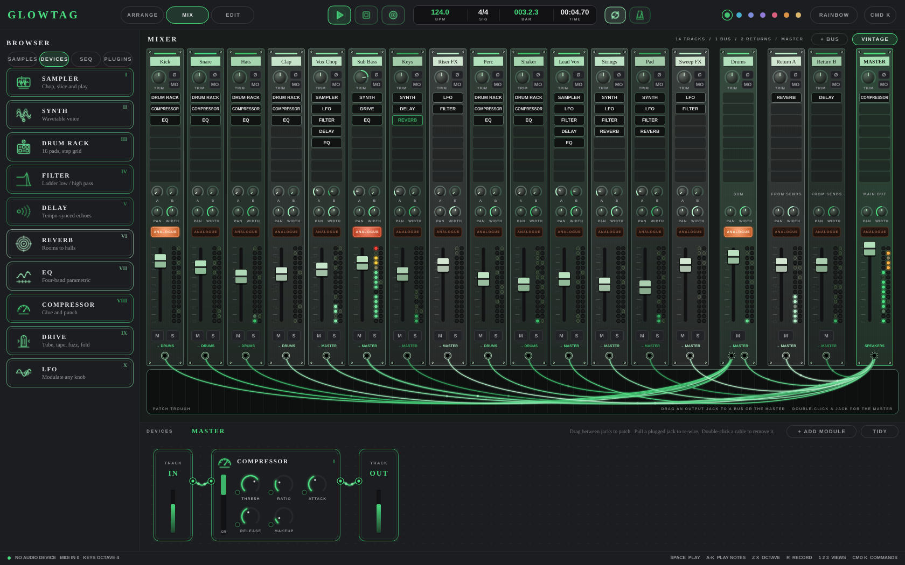
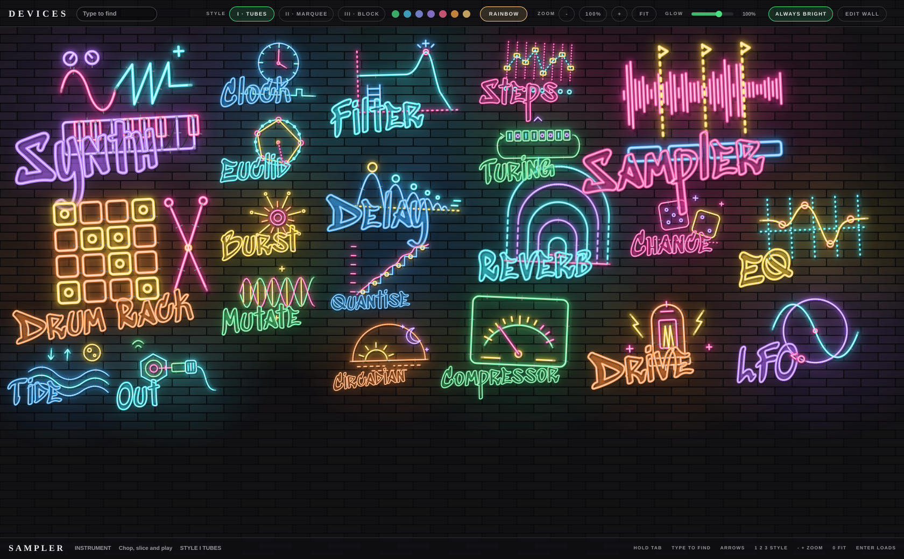
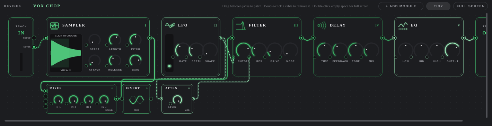

# GLOWTAG

A personal, MIDI- and sampling-focused DAW for macOS, built natively with C++ and [JUCE](https://juce.com).
The look is graffiti art drawn as calm neon line work: thin outlines, serif caps headings and
detailed glowing icons, on a dark grey background. One theme colour by default (green), with a
Rainbow mode that uses the full card palette.








## Build on a Mac

You need Xcode (from the App Store) and CMake (`brew install cmake`).

```sh
git clone https://github.com/jackhenrymillar-collab/glowtag.git
cd glowtag
cmake -B build -G Xcode          # first run downloads JUCE 8.0.4, takes a few minutes
open build/GLOWTAG.xcodeproj     # pick the "Glowtag" scheme and press Run
```

Or build from the terminal:

```sh
cmake --build build --config Release
open build/Glowtag_artefacts/Release/GLOWTAG.app
```

If you already have JUCE checked out, add `-DGLOWTAG_JUCE_DIR=/path/to/JUCE` to the first command.

Without the Xcode app, Apple's Command Line Tools are enough (`xcode-select --install`):

```sh
cmake -B build -DCMAKE_BUILD_TYPE=Release    # plain Makefiles instead of -G Xcode
cmake --build build -j
open build/Glowtag_artefacts/GLOWTAG.app
```

If CMake complains about the SDK, point it at the one your tools ship, e.g.
`SDKROOT=/Library/Developer/CommandLineTools/SDKs/MacOSX26.5.sdk cmake -B build ...`.

## Using it

| Key | Action |
| --- | --- |
| Space | Play / stop. Stop returns to where play started; stop again to go to the start |
| A W S E D F T G Y H U J K O L P | Play notes on the selected track (Z and X change octave) |
| R | Arm recording. Notes you play while playing are recorded into the selected track |
| Delete | Delete the selected clip (Arrange) or note (Edit) |
| Cmd D | Duplicate the selected clip |
| 1 / 2 / 3 | Arrange / Mix / Edit |
| Cmd K | Command palette (files, views, transport, theme) |
| Esc | Leave the full screen device panel |
| Tab | The device wall: hold to show it, let go to hide it. A quick tap leaves it open until Tab or Esc |
| Cmd N / Cmd O / Cmd S / Shift Cmd S | New, open, save, save as (also in the File menu, with Open Recent) |
| Up / Down | Select track |

Any MIDI keyboard that is plugged in plays and records into the selected track too.

**Arrange**
- Click the ruler to move the playhead. Drag along the strip under the bar numbers to set the loop, and toggle looping with the loop button in the top bar.
- Drag clips to move them (between lanes too), drag their right edge to resize, Alt-drag to copy, and right-click for duplicate, delete and loop length.
- Double-click an empty lane to make a new clip, or a clip to open it in Edit.
- Drop audio files (wav, aiff, flac, mp3) onto a lane to make audio clips.
- Cmd + scroll zooms, scroll moves along the timeline.

**Edit** (piano roll for the selected clip)
- Pencil: click to draw a note and drag right to set its length. Drag notes to move them, drag the right edge to resize.
- Scissors split a note, the velocity tool drags velocity, and the lane under the grid sets velocity per column.
- Double-click a note (or press Delete) to remove it. Scroll moves up and down the keyboard.
- Loop sets how often the clip's notes repeat inside it.

**Devices** (bottom panel) is a modular patch that really runs the sound. Instruments are virtual
analog: the Synth has two drifting band-limited oscillators and a sub through a transistor ladder
filter with analog-curve envelopes, the Sampler plays built-in or dropped samples, and the Drum Rack
has sixteen pads (click to hear, right-click to choose a sample, drop a file on a pad). Effects:
Filter (ladder), Drive (tube / tape / fuzz / fold), Delay (tempo-synced, ping-pong), Reverb, EQ,
Compressor, and an LFO that can modulate any knob. The panel is modular. Each module you add wires itself in (effects go at the end of the
chain, an LFO patches into the last module's first free knob). Drag between jacks to patch,
pull a plugged-in jack to re-wire it, double-click a cable to remove it, drag a module's header
to move it, and right-click a module to remove it. Double-click a device in the browser to add it.
Tidy lines everything up in signal order.

The panel has two rows. The top row holds instruments and effects. The row beneath it is half the
height and holds **utilities**: Attenuator (turn a signal down), Mixer (four inputs summed, each with
its own level), Inverter (flip a signal over), Crossfade (blend A into B) and Slew (smooth a signal).
Utilities come unpatched and work on sound or on modulation, whichever you plug into them first; the
card says SOUND, MOD or FREE.

Jacks carry one of three kinds of signal, and a cable only joins two jacks of the same kind:
- **Sound** (large round jacks, solid cables): audio between devices.
- **Notes** (square jacks, cables drawn as a row of bulbs): the track's MIDI, which is note pitch,
  velocity and note on / off from clips, the keyboard, a MIDI controller and the sequencer rack. It
  comes out of Track In's NOTES jack and goes only to an instrument's notes input. An instrument
  takes nothing else, and only plays when a notes cable reaches it.
- **Modulation** (small jacks, dashed cables): an LFO or a utility into a knob.

While you drag a cable the jacks it cannot go to dim, and the line at the top of the panel says why
a jack will not take it. An audio clip on a track that also has an instrument plays through Track
In's SOUND jack, mixed in beside the instrument.

**Full screen**: double-click any empty space in the device panel (or press Full screen) to give the
patch the whole window, enlarged to fit. Esc or another double-click puts it back.



**Sequence** (the rolling sequencer). Press SEQ on an instrument or sampler track and its clips
make way for a Eurorack-style rack that plays the track live, in time with the song. The rack
starts as Clock, Steps, Quantise and Out, already patched. Add modules from the browser's
Sequence tab or the rack's own menu; each wires itself in sensibly and can be re-patched by
dragging between jacks (pull a plugged jack to move its lead, double-click a lead to remove it).
Right-click a module to move or remove it; Back to clips returns the track to its arrangement.

| Module | What it does |
| --- | --- |
| Clock | Sixteenths from the song (divided or multiplied), swing, or free-running with the transport stopped. Reset, Clk and Bar outs |
| Steps | 16 pitch sliders with a gate button under each. Gate length, slide, octave, five directions (forward, reverse, pendulum, brownian, random), length. Cv inputs for direction, probability and length |
| Euclid | Hits spread evenly round a circle of steps, rotatable. Accent on the downbeat |
| Turing | A shift-register melody that evolves with probability and locks into a loop at zero |
| Burst | Ratchets: a burst of gates from one trigger, with a velocity ramp |
| Chance | Lets gates through by probability, drifts the pitch, remembers, and can lock its decisions into a loop |
| Quantise | Pulls any pitch onto a scale (twelve scales, any root), nearest / up / down |
| Mutate | Slowly wanders away from the pitch coming in |
| Circadian | A slow day-and-night cycle following song bars, the wall clock (a minute to a day) or real daylight. Cv, Dawn, Noon, Dusk and inverted outs |
| Tide | Tempo-synced LFO from a sixteenth to eight bars, five shapes |
| Out | Plays the track's instrument: mono or four voices, octave, and a Mod lead that moves the instrument's character knob |

**Mix**: a console of channel strips over a **patch trough**. Each strip has, from the top: its name,
**Trim** (level into the channel, -12 to +12 dB) with **phase flip** and **mono**, the devices in its
patch (click one and the device panel below jumps to it), two send knobs, **pan** and **width**, the
**Analogue** lamp, the fader with a level meter and an amber gain-reduction meter (from the first
compressor in the chain), mute / solo, and its patch jacks. The level meter runs in the theme colour,
turns yellow near the top and red at the peak; an over stays lit for a moment.

Every strip ends in an **output jack** and a cable hangs from it to whatever it feeds. Drag the jack
onto a bus or the master to re-patch it, or click the jack and then the destination; double-click a
jack to send it back to the master. Right-click a strip for the same choices as a menu, and to rename
it. **+ Bus** adds a bus (a channel other channels are patched into); buses can feed other buses, and
right-click removes one. After the tracks and buses come **Return A** (a reverb), **Return B** (a
delay) and the **Master** (a compressor). Sends are post-fader and feed the returns. Click any strip
to select it and its patch appears in the device panel underneath, so buses, returns and the master
take devices and plugins too.

**Analogue** models a console channel: a little low-end weight, even harmonics and a softened top.
Quiet material is only warmed; push Trim and it breaks up like driven hardware, and the lamp turns
from orange to red. **Vintage** (top right of the mixer) redraws the console as worn hardware with
tape labels and LED ladder meters, tinted by the theme colour.

**Device wall** (hold Tab, or View > Device Wall): every instrument, effect and rack module as a
neon piece on one brick wall. Hover or use the arrows to light one, then click or press Enter to
load it on the selected track (rack modules switch the track to its sequencer rack). Type to find
a device by name; Esc clears the search, then closes the wall.
- Three styles, for the whole wall (Style I / II / III in the top bar) or for the lit piece alone
  (keys 1, 2, 3): **Tubes** (line drawing and a handstyle tag), **Marquee** (bulb dots and sign
  lettering) and **Block** (extruded block letters with a panel emblem). Rainbow gives each style
  its own palette; otherwise the wall follows the theme colour.
- **Always bright** lights every piece, and the one under the pointer grows a little. **Glow** sets
  how much light the tubes throw (0 to 150%). Zoom with - and +, or Cmd + scroll; **Fit** (key 0)
  scales the whole wall onto the screen.
- **Edit wall**: drag pieces to move them, pull a corner to resize, type a new title and choose a
  style for each one. Arrows nudge the selected piece. Reset wall puts everything back.
- The layout, titles, styles and settings are saved with the app's settings. With the transport
  running the tubes swell on the beat, and now and then one flickers.

**Plugins**: the browser's Plugins tab lists the AU and VST3 plugins on the Mac. Scan once to find
them, then double-click one to add it to the selected track, return or master as a **Plugin**
device. It wires itself into the chain like any other device, has Mix and Gain knobs, and
double-click (or right-click) its card to open the plugin's own window. Instruments take the
track's notes; their state is saved inside the project. Scanning happens in the background and a
plugin that crashes the scan is skipped next time.

**Saving**: projects are JSON files with a `.glowtag` extension holding every track, clip, note,
device patch, rack, plugin state, send and fader. Audio clips reference their files by path. The
title bar shows the file and a dot when there are unsaved changes; quitting with changes asks
first, and the last project opens again next time.

## Tests

Offline checks for the engine (transport, loop, clips, live MIDI, recording, patching, signal kinds and the utility modules, the sequencer rack,
save / load round trips, sends / returns / master routing, bus patching, the console channel, and the
device wall's layout, search, arrow keys and saved state):

```sh
cmake -B build -G Xcode -DGLOWTAG_TESTS=ON
cmake --build build --target GlowtagTests --config Debug
./build/GlowtagTests_artefacts/Debug/GlowtagTests
```

## Code layout

```
Source/
  Main.cpp              app and window
  MainComponent.*       owns the project, engine and views; layout, shortcuts, File menu and saving
  Theme.*               colours (one-colour shades or Rainbow) and fonts
  Engine/
    Project.*           tracks, returns, master, clips, tempo; JSON save and load
    Patch.*             modular device patch per track: modules, jacks, signal kinds, cables, auto-wiring
    Graph.*             the running audio side of a patch (virtual analog nodes, hosted plugins)
    PluginHost.*        AU / VST3 scanning and instance creation
    Sequencer.*         rolling sequencer rack: modules, cables, auto-wiring, and the tick-based runtime
    AudioEngine.*       plays clips, live MIDI and sequencer racks through each slot's graph, then sends, returns and master
  UI/
    Icons.*             glowing line-art icons and panel drawing
    GlowLookAndFeel.*   pill buttons, glowing knobs, faders
    TopBar, BrowserPanel, TrackList, ArrangerView, DevicePanel,
    SequencerPanel, MixerView, EditorView, StatusBar
    DeviceWallModel.*   the wall's pieces: default layout, search, arrow-key moves, saved state (no graphics)
    DeviceWallArt.*     neon rendering: tubes, bulbs, glow, lettering, bricks
    DeviceWallArtData.inc   the 63 drawings (21 devices x 3 styles), generated by tools/wall-art
    DeviceWall.*        the overlay itself: Tab, top bar, edit mode, animation
  Fonts/                Sedgwick Ave Display, Monoton and Bowlby One (SIL Open Font License, texts alongside)
tools/
  wall-art/             the drawings as SVG-building JavaScript; `node tools/wall-art/generate.mjs` rewrites the .inc
```

## Roadmap

1. **Foundation** (done): app shell, audio engine, themed UI with Arrange, Mix and Edit.
2. **Core engine** (done): timeline with MIDI and audio clips, loop, metronome, piano roll editing, MIDI keyboard playing and recording.
3. **Sounds and devices** (done): virtual analog synth, sampler, drum rack and effects running through the modular patch.
3b. **Eurorack rolling sequencer** (done): a per-track alternative to clips, with module-style visuals.
4. **Mix, save and plugins** (this version): sends, two returns and a master chain; saving and loading projects; AU / VST3 hosting.
5. **Polish**: adding and removing tracks, undo, automation playback, more piano roll tools.
